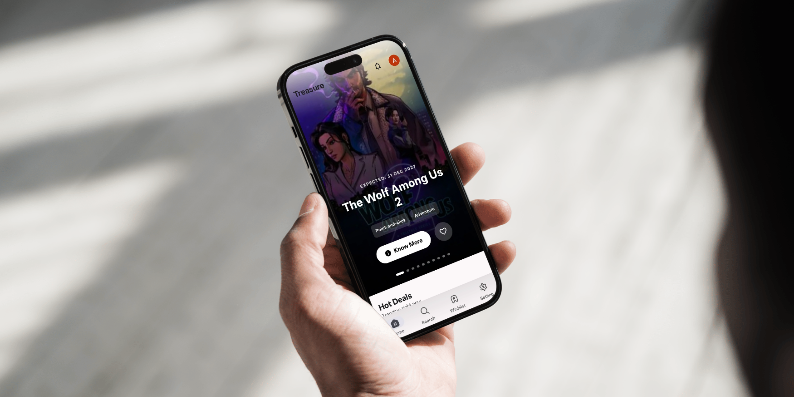
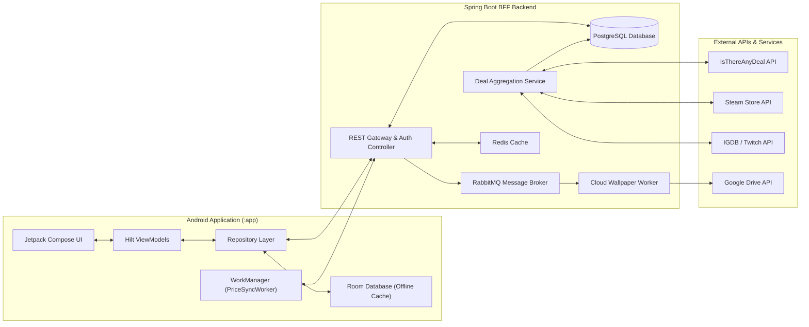
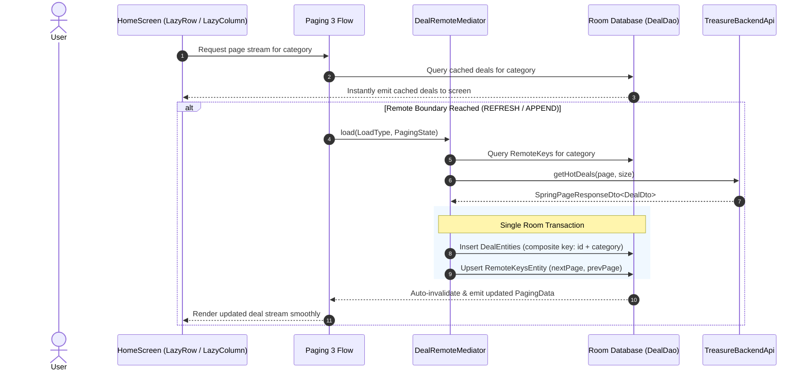
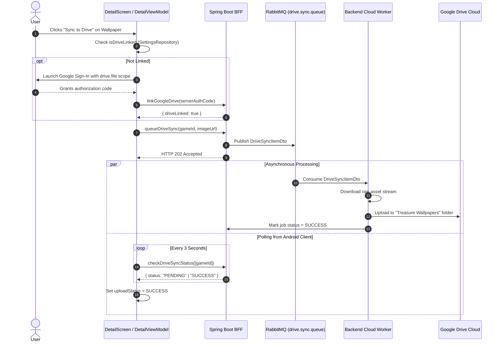
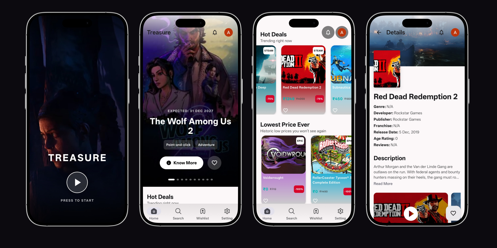
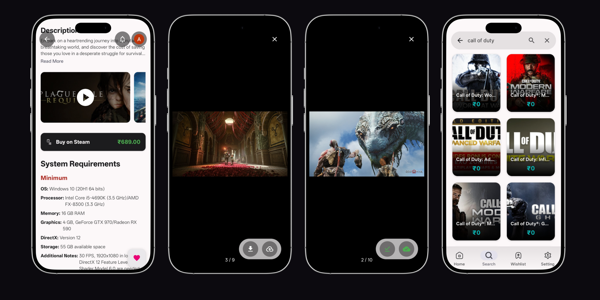
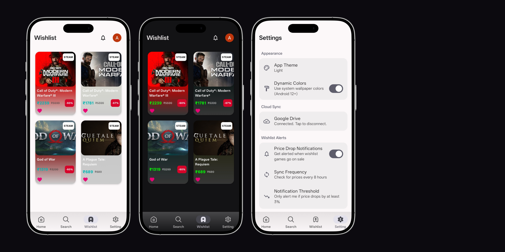

<p align="center">
  
</p>

<h1 align="center">Treasure</h1>

<p align="center">
  <strong>Enterprise-Grade Video Game Deal Tracker & Cloud-Connected Media Companion for Android</strong>
</p>

<p align="center">
  
  
  
  
  
  
  
  
  
  
  
</p>

---

## 1. Overview & Technical Value Proposition

**Treasure** is a modern, reactive, offline-first Android application designed to track and discover digital video game discounts, historic pricing lows, and free game promotions across major digital storefronts, including **Steam**, **GOG**, **Epic Games Store**, and more.

Built according to modern Android development standards, Treasure pairs an unbundled **Jetpack Compose / Material 3** user experience with an enterprise **Spring Boot Backend-for-Frontend (BFF)**. The client utilizes an offline-first caching layer with **Room Database** and **Paging 3 RemoteMediator**, background price drop verification via **AndroidX WorkManager**, zero-friction Google Sign-In via **Credential Manager**, and an asynchronous cloud wallpaper sync pipeline targeting the **Google Drive API**.

Companion Backend: [Treasure Backend Repository](https://github.com/ArnabKrJana/Treasure-Backend.git)

---

## 2. System Architecture & Workflows

### 2.1 End-to-End System Blueprint



---

### 2.2 Offline-First Paging 3 Architecture (`RemoteMediator`)

Categorized deals (Hot Deals, Lowest Price Ever, Mac Deals, Linux Deals) are loaded seamlessly with bidirectional network and disk coordination:



---

### 2.3 Asynchronous Google Drive Wallpaper Pipeline

Treasure allows users to backup 4K screenshots and desktop wallpapers directly to their private Google Drive storage without consuming local device storage or mobile bandwidth:



---

## 3. Core Feature Highlights

| Feature | Technical Implementation | Highlights |
| :--- | :--- | :--- |
| **Deal Discovery & Filtering** | `DealRemoteMediator`, `Paging 3`, `Room` | Multi-category scrolling feeds (`HOT_DEALS`, `LOWEST_PRICE`, `MAC_DEALS`, `LINUX_DEALS`) with composite primary keys (`["id", "category"]`) preventing cross-category key collisions. |
| **Immersive Media & Overlays** | `AndroidX Media3 ExoPlayer`, `Coil 3` | In-app 1080p trailer streaming with lifecycle observer management (`ON_PAUSE` / `ON_STOP`), pinch-to-zoom Coil image viewer, and dynamic blur backgrounds (`Modifier.blur()`). |
| **Smart Price-Drop Alerts** | `WorkManager`, `PriceSyncWorker` | Battery-conscious, network-constrained periodic background synchronization checking wishlist deals against remote thresholds, dispatching deep-linked Android notifications. |
| **Cloud Wallpaper Backups** | `Google Credential Manager`, `Google Drive API` | Server-assisted cloud uploads using RabbitMQ asynchronous workers with non-blocking status polling and re-authentication challenge handling. |
| **Material You Design System** | `Jetpack Compose Material 3` | Dynamic color extraction from device wallpaper on Android 12+, dark/light high-contrast palettes, and scroll-linked app bar alpha animations. |
| **Security & Credential Storage** | `Security-Crypto EncryptedSharedPreferences` | Hardware-backed keystore token persistence (`MasterKey`), atomic token refresh via OkHttp `TokenAuthenticator`, and circular DI resolution via Dagger `Provider<T>`. |

---

## 4. Repository Structure & Package Documentation Index

Every individual package within the `:app` module features an exhaustive, standalone technical guide detailing its architecture, file taxonomy, sequence flows, and threading models.

| Package | Path | Architectural Layer | Package Documentation Guide |
| :--- | :--- | :--- | :--- |
| **Core Utilities** | `com.example.treasure.utils` | Foundation | [📘 Utilities Architecture Guide](app/src/main/java/com/example/treasure/utils/README.md) |
| **Domain Layer** | `com.example.treasure.domain` | Clean Architecture Domain | [📘 Domain Layer Architecture Guide](app/src/main/java/com/example/treasure/domain/README.md) |
| **Data — Local Persistence** | `com.example.treasure.data.local` | Data Persistence | [📘 Room Local Persistence Guide](app/src/main/java/com/example/treasure/data/local/README.md) |
| **Data — Remote Networking** | `com.example.treasure.data.remote` | Network & API | [📘 Remote Networking Guide](app/src/main/java/com/example/treasure/data/remote/README.md) |
| **Data — Repositories & Mappers** | `com.example.treasure.data.repositoryImpl` | Repository Implementation | [📘 Repositories & Mappers Guide](app/src/main/java/com/example/treasure/data/repositoryImpl/README.md) |
| **Dependency Injection** | `com.example.treasure.di` | Dagger / Hilt DI | [📘 Dependency Injection Guide](app/src/main/java/com/example/treasure/di/README.md) |
| **Background Workers** | `com.example.treasure.workers` | WorkManager Background Tasks | [📘 WorkManager Workers Guide](app/src/main/java/com/example/treasure/workers/README.md) |
| **UI — Design System Theme** | `com.example.treasure.ui.theme` | Presentation (Theme) | [📘 Material 3 Design System Guide](app/src/main/java/com/example/treasure/ui/theme/README.md) |
| **UI — Reusable Components** | `com.example.treasure.ui.uiComponents` | Presentation (Components) | [📘 UI Components & Media Guide](app/src/main/java/com/example/treasure/ui/uiComponents/README.md) |
| **UI — ViewModels** | `com.example.treasure.ui.viewModels` | Presentation (State Holders) | [📘 ViewModels & UDF State Guide](app/src/main/java/com/example/treasure/ui/viewModels/README.md) |
| **UI — Screens** | `com.example.treasure.ui.screens` | Presentation (Screen Views) | [📘 Screens & Composables Guide](app/src/main/java/com/example/treasure/ui/screens/README.md) |
| **UI — Type-Safe Navigation** | `com.example.treasure.ui.navigationGraphs` | Presentation (Navigation) | [📘 Navigation Graphs Guide](app/src/main/java/com/example/treasure/ui/navigationGraphs/README.md) |

---

## 5. Getting Started & Build Instructions

### Prerequisites
- **Android Studio Ladybug (2024.2.1)** or newer
- **JDK 21** configured as your Gradle JDK
- **Android SDK Platform 35 (Android 15)** installed
- Active Google Cloud Console project with:
  - OAuth 2.0 Client IDs (Android Client & Web Server Client)
  - Google Drive API enabled

### Building the Project

1. **Clone the Repository:**
   ```bash
   git clone https://github.com/ArnabKrJana/Treasure-gamedeals.git
   cd Treasure-gamedeals
   ```

2. **Configure Constants:**
   Update your Google Web Client ID and backend server base URLs in:
   - [`Constants.kt`](app/src/main/java/com/example/treasure/utils/Constants.kt)

3. **Compile Kotlin & Verify Build:**
   ```bash
   ./gradlew compileDebugKotlin
   ```

4. **Assemble Debug APK:**
   ```bash
   ./gradlew assembleDebug
   ```

---

## 6. Screenshots & Visual Showcase

<p align="center">
  
  &nbsp;
  
  &nbsp;
  
</p>

---

## 7. Credits

Developed by **Arnab Kumar Jana**
- Companion Backend: [Treasure-Backend on GitHub](https://github.com/ArnabKrJana/Treasure-Backend.git)
