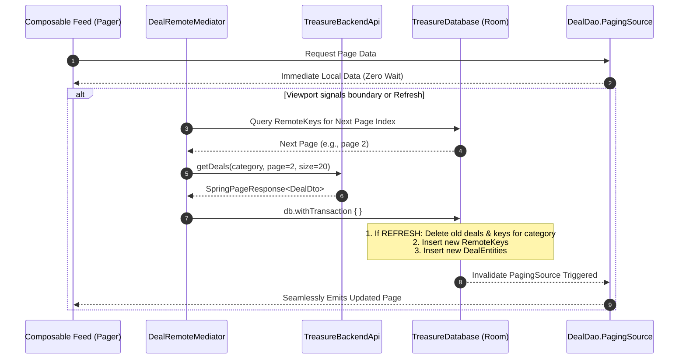
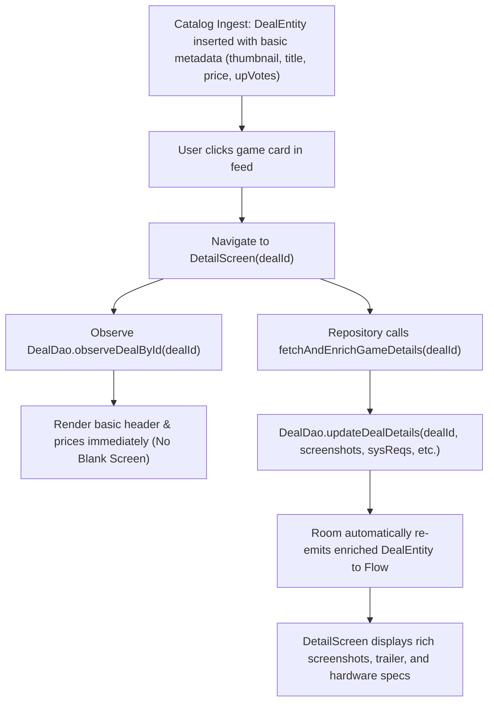

# Package Architecture: `com.example.treasure.data.local`

## 1. Overview & Architectural Scope

The `data.local` package encapsulates the application's offline-first persistence layer, built on Android Jetpack Room and SQLite. 

Room functions as the **Single Source of Truth (SSOT)** across the entire application:
- **Zero-Latency Offline Startup**: UI composables never await network responses before rendering; they query local Room DAOs directly via reactive `Flow` and `PagingSource` streams.
- **Atomic Cache Synchronization**: Coordinates with backend services via Paging 3 [`DealRemoteMediator`](remoteMediators/DealRemoteMediator.kt) to synchronize remote pages into local tables in isolated, transactional database operations.
- **Two-Tier Model Architecture**: Feed entities store minimal metadata for rapid layout rendering, while detailed attributes (system specifications, media galleries, alternative storefront deals) are enriched lazily upon user interaction.

Database Configuration:
- **Database Class**: [`TreasureDatabase`](TreasureDatabase.kt)
- **Database Version**: `5` (`exportSchema = false`)
- **Converters**: [`Converters`](entity/TypeConverters.kt) (JSON mapping for complex nested collections and enum conversions via Gson)

---

## 2. File Inventory & Architectural Taxonomy

| Subpackage | File / Component | Architectural Role | Key Responsibilities & Behaviors |
| :--- | :--- | :--- | :--- |
| Root | [`TreasureDatabase.kt`](TreasureDatabase.kt) | Room Database | Central database definition registering entities, version 5 schema, type converters, and abstract DAO accessors. |
| `dao` | [`DealDao.kt`](dao/DealDao.kt) | Data Access Object | Manages deal feeds (`PagingSource`), category wiping, reactive deal observation (`Flow`), and lazy detail updates. |
| `dao` | [`DownloadedAssetDao.kt`](dao/DownloadedAssetDao.kt) | Data Access Object | Tracks local media downloads (wallpapers) matching Android DownloadManager task IDs to asset identifiers. |
| `dao` | [`NotificationDao.kt`](dao/NotificationDao.kt) | Data Access Object | Stores price drop/hike alert history, unread badge counters (`Flow<Int>`), and bulk read acknowledgments. |
| `dao` | [`RemoteKeysDao.kt`](dao/RemoteKeysDao.kt) | Data Access Object | Persists Paging 3 pagination cursor keys (`prevKey`, `nextKey`) mapped to composite query IDs. |
| `dao` | [`UserInteractionDao.kt`](dao/UserInteractionDao.kt) | Data Access Object | Tracks user cart items and wishlisted games, exposing reactive `Flow` lists and O(1) membership ID streams. |
| `entity` | [`DealEntity.kt`](entity/DealEntity.kt) | Room Entity | Cached game deal table with composite primary key `(id, category)`, feed metadata, and lazy enrichment columns. |
| `entity` | [`DiscoveryEntity.kt`](entity/DiscoveryEntity.kt) | Room Entity | Trending games and new releases sourced from IGDB with asynchronous ITAD price resolution states. |
| `entity` | [`DownloadedAssetEntity.kt`](entity/DownloadedAssetEntity.kt) | Room Entity | Wallpaper asset persistence linking internal IDs to DownloadManager references and file paths. |
| `entity` | [`FreeGameEntity.kt`](entity/FreeGameEntity.kt) | Room Entity | Promotional free games from Epic Games Store, including vault statuses and countdown claim windows. |
| `entity` | [`NotificationEntity.kt`](entity/NotificationEntity.kt) | Room Entity | Log of detected price fluctuations (oldPrice vs newPrice) generated by background sync workers. |
| `entity` | [`RemoteKeys.kt`](entity/RemoteKeys.kt) | Room Entity | Cursor pagination keys used by `DealRemoteMediator` to resolve next and previous API pages. |
| `entity` | [`TypeConverters.kt`](entity/TypeConverters.kt) | Room Converters | Gson-backed serialization converters for `List<String>`, `List<StoreDeal>`, `List<SystemRequirementEntity>`, and `DealCategory`. |
| `entity` | [`UserInteractionEntity.kt`](entity/UserInteractionEntity.kt) | Room Entity | Local snapshot record of user-saved games (cart and favorites) supporting full offline screen access. |
| `entity.enums` | [`Role.kt`](entity/enums/Role.kt) | Security Enum | User authorization role definitions (`USER`, `ADMIN`). |
| `remoteMediators` | [`DealRemoteMediator.kt`](remoteMediators/DealRemoteMediator.kt) | Paging 3 Mediator | Orchestrates network-to-database synchronization for paginated deal feeds across categories. |

---

## 3. Core Architecture & Data Flows

### A. Paging 3 + Room Network-to-Database Synchronization

[`DealRemoteMediator`](remoteMediators/DealRemoteMediator.kt) coordinates with [`DealDao`](dao/DealDao.kt) and [`RemoteKeysDao`](dao/RemoteKeysDao.kt) using Room transactions:



### B. Composite Primary Keys & Category Isolation

In [`DealEntity`](entity/DealEntity.kt), the primary key is explicitly compound:
```kotlin
@Entity(
    tableName = "deals",
    primaryKeys = ["id", "category"]
)
data class DealEntity(...)
```
**Architectural Purpose**: The same video game deal can appear across multiple feeds simultaneously (e.g., in `HOT_DEALS`, `LOWEST_PRICE`, and `MAC_DEALS`). Using `(id, category)` prevents category collisions, allowing each feed to independently manage its `listingIndex` and cache invalidation without deleting the game from other screens.

### C. Two-Tier Lazy Detail Enrichment

To optimize initial feed ingest bandwidth, remote deal feeds do not deliver full screenshots, system hardware requirements, or trailers:



### D. Offline-First User Interaction Snapshots

[`UserInteractionEntity`](entity/UserInteractionEntity.kt) stores both state flags (`isAddedToCart`, `isFavorite`) and immutable metadata snapshots (`title`, `thumbnail`, `currentPrice`, `originalPrice`, `storeId`). When a user opens their Cart or Wishlist while completely offline (airplane mode), the UI renders immediately without requiring network calls or joining with online tables.

---

## 4. Threading & Transactional Integrity

- **Main-Thread Safety**: All DAO queries marked with `suspend` or returning `Flow` / `PagingSource` automatically execute off the Android main thread on Room's internal background executor pool.
- **Atomic Rollbacks**: [`DealRemoteMediator`](remoteMediators/DealRemoteMediator.kt) executes stale cache invalidation, key persistence, and batch insertions inside `db.withTransaction { ... }`. If network mapping fails or disk write errors occur, the transaction aborts with zero partial corruption.
