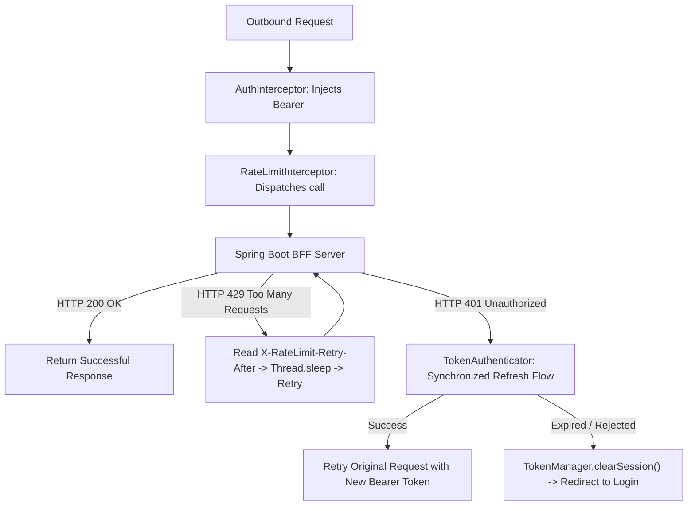
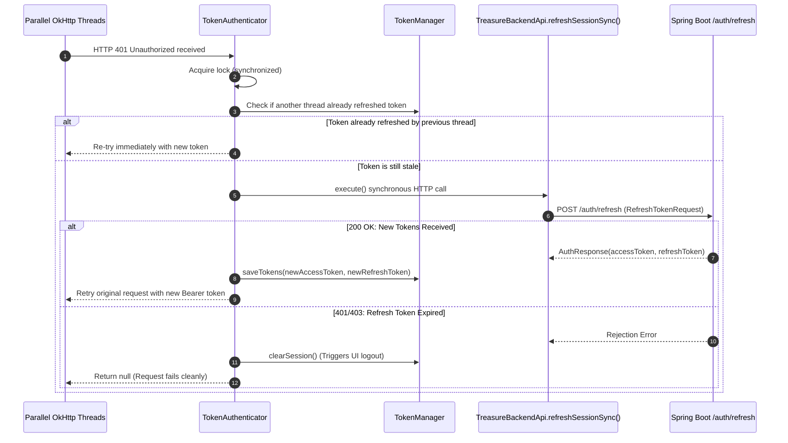
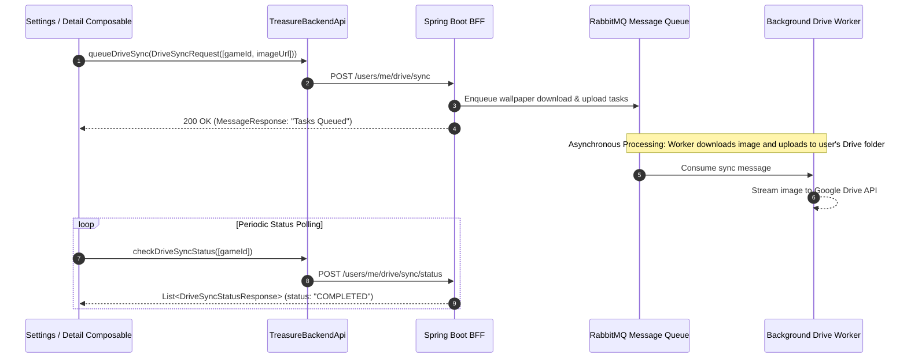

# Package Architecture: `com.example.treasure.data.remote`

## 1. Overview & Architectural Scope

The `data.remote` package manages all outbound network communications with external REST services, centered around the Spring Boot Backend-for-Frontend ([`Treasure-Backend`](https://github.com/ArnabKrJana/Treasure-Backend)) hosted on Render.

Key Architectural Responsibilities:
- **Declarative REST Contracts**: Defines Retrofit endpoints ([`TreasureBackendApi`](apiService/TreasureBackendApi.kt)) spanning authentication, paginated catalog discovery, wishlist syncing, and Google Drive cloud backups.
- **Resilient OkHttp Pipeline**: Implements automatic JWT Bearer injection ([`AuthInterceptor`](apiService/AuthInterceptor.kt)), automatic backoff retry for HTTP 429 rate-limiting ([`RateLimitInterceptor`](apiService/RateLimitInterceptor.kt)), and thread-safe synchronized token renewal ([`TokenAuthenticator`](apiService/TokenAuthenticator.kt)).
- **Modern Google Identity**: Manages Google OAuth 2.0 Credential Manager flows via [`GoogleAuthHelper`](auth/googleAuthHelper/GoogleAuthHelper.kt).
- **Network Models**: Data Transfer Objects (DTOs) annotated with `@Keep` and `@SerializedName` to guarantee R8 / ProGuard obfuscation safety.

---

## 2. File Inventory & Architectural Taxonomy

| Subpackage | File / Component | Architectural Role | Key Responsibilities & Behaviors |
| :--- | :--- | :--- | :--- |
| `apiService` | [`AuthInterceptor.kt`](apiService/AuthInterceptor.kt) | OkHttp Interceptor | Injects `Authorization: Bearer <accessToken>` headers into outbound network calls. |
| `apiService` | [`RateLimitInterceptor.kt`](apiService/RateLimitInterceptor.kt) | OkHttp Interceptor | Catches HTTP 429 Too Many Requests, reads `X-RateLimit-Retry-After` header, pauses thread, and retries. |
| `apiService` | [`TokenAuthenticator.kt`](apiService/TokenAuthenticator.kt) | OkHttp Authenticator | Catches HTTP 401 challenges, executes synchronized refresh token renewal, and retries original requests. |
| `apiService` | [`TreasureBackendApi.kt`](apiService/TreasureBackendApi.kt) | Retrofit Interface | Primary REST API interface defining endpoints for auth, game deals, user profiles, and wishlists. |
| `auth.googleAuthHelper` | [`GoogleAuthHelper.kt`](auth/googleAuthHelper/GoogleAuthHelper.kt) | Identity Manager | AndroidX Credential Manager helper prompting Google ID account selection bottom sheets. |
| `dto` | [`AuthUserDtos.kt`](dto/AuthUserDtos.kt) | Data Transfer Objects | DTOs for login requests, token refresh, account messages, user profile payloads, and role enums. |
| `dto` | [`DriveSyncDtos.kt`](dto/DriveSyncDtos.kt) | Data Transfer Objects | DTOs for queuing and status polling of asynchronous Google Drive media wallpaper backups. |
| `dto` | [`GameDealDtos.kt`](dto/GameDealDtos.kt) | Data Transfer Objects | Comprehensive DTOs for game deals, store offerings, hardware requirements, and categories. |
| `dto` | [`SpringPageResponseDto.kt`](dto/SpringPageResponseDto.kt) | Generic DTO | Generic container deserializing Spring Data `Page<T>` pagination responses (`content`, `totalPages`, `last`). |
| `dto` | [`WishlistPriceDto.kt`](dto/WishlistPriceDto.kt) | Data Transfer Objects | Lightweight price DTO (`current`, `original`) used for periodic background price monitoring. |

---

## 3. Core Architecture & Data Flows

### A. OkHttp Interceptor & Authenticator Pipeline

Every HTTP request traverses an orchestrated pipeline before reaching the network:

### B. Synchronized Token Refresh Sequence

To avoid parallel refresh storms when multiple concurrent requests expire simultaneously:

### C. Asynchronous Google Drive Media Backup (RabbitMQ Integration)

The client interacts with the backend's distributed asynchronous worker pipeline to archive high-resolution game wallpapers without blocking mobile threads:

---

## 4. Threading & Concurrency Guarantees

- **Main-Thread Safety**: Asynchronous Retrofit methods are defined with `suspend` and invoked inside coroutines on `Dispatchers.IO`, ensuring zero main-thread network execution.
- **Synchronous Refresh Execution**: [`TokenAuthenticator`](apiService/TokenAuthenticator.kt) purposely avoids `runBlocking` for the network hop and invokes [`TreasureBackendApi.refreshSessionSync`](apiService/TreasureBackendApi.kt) via Retrofit's blocking `Call.execute()`. This satisfies OkHttp's synchronous authenticator contract and prevents coroutine dispatcher deadlocks.
- **Circular Dependency Decoupling**: [`TokenAuthenticator`](apiService/TokenAuthenticator.kt) injects `Provider<TreasureBackendApi>` rather than a direct reference. This allows Dagger Hilt to construct OkHttpClient before Retrofit is instantiated without triggering circular dependency initialization errors.
