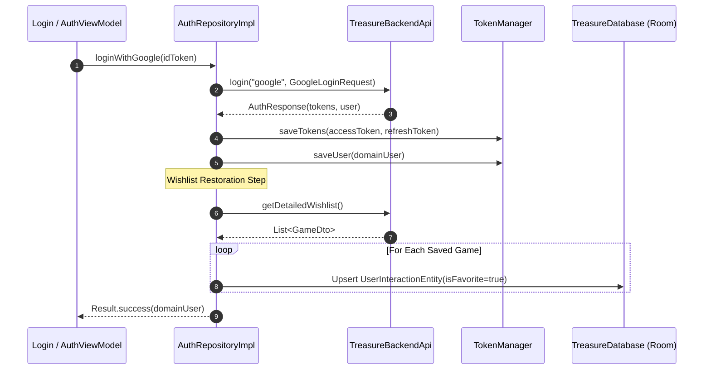
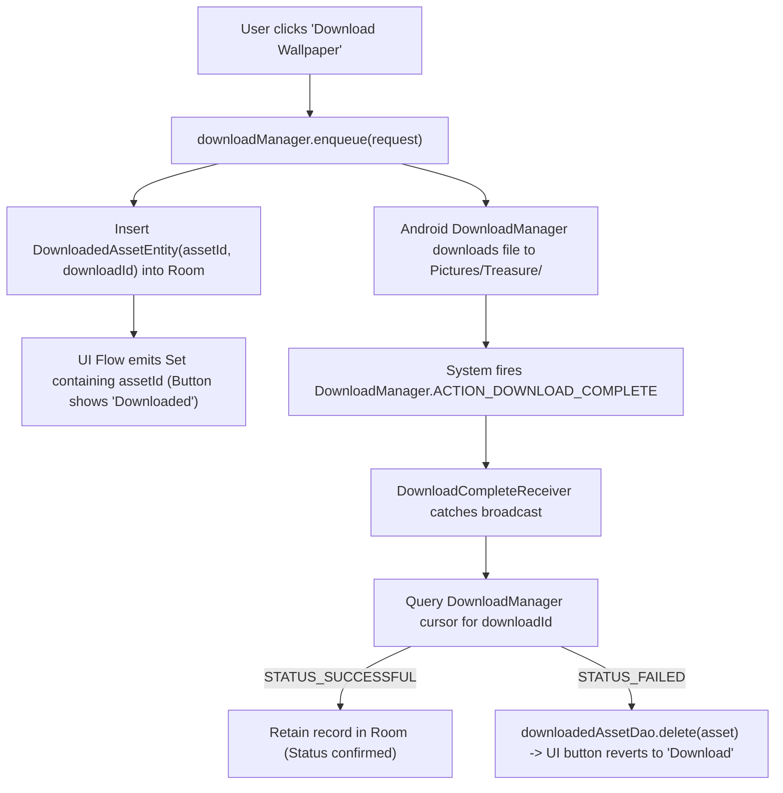

# Package Architecture: `com.example.treasure.data.repositoryImpl` (and Data Helpers)

## 1. Overview & Architectural Scope

The `data.repositoryImpl` package (along with [`Mappers.kt`](../Mappers.kt) and [`DownloadCompleteReceiver`](../receiver/DownloadCompleteReceiver.kt)) provides the concrete implementations of domain repository contracts.

Architectural Responsibilities:
- **Offline-First Synchronization**: Implements [`GameRepository`](../../domain/repository/GameRepository.kt), orchestrating Paging 3 deal streams, lazy detail enrichment, and optimistic user interaction mutations (cart & wishlist).
- **Session & Identity Management**: Implements [`AuthRepository`](../../domain/repository/AuthRepository.kt), exchanging Google OAuth tokens, persisting JWT credentials via [`TokenManager`](../../utils/TokenManager.kt), and restoring cloud wishlists upon login.
- **Media Asset Downloads**: Implements [`LocalDownloadRepository`](../../domain/repository/LocalDownloadRepository.kt), bridging Android's system `DownloadManager` with Room database tracking and broadcast reconciliation.
- **Persistent Preferences**: Implements [`SettingsRepository`](SettingsRepository.kt), managing application settings (theme, dynamic color, sync frequency, notification thresholds) via Jetpack DataStore Preferences.
- **Model Translation**: Provides pure Kotlin extension mappers translating network DTOs into persistent Room entities.

---

## 2. File Inventory & Architectural Taxonomy

| File / Component | Architectural Role | Key Responsibilities & Behaviors |
| :--- | :--- | :--- |
| [`AuthRepositoryImpl.kt`](AuthRepositoryImpl.kt) | Repository Implementation | Executes Google login, saves session tokens, populates local wishlist from cloud on login, wipes database on logout/deletion. |
| [`GameRepositoryImpl.kt`](GameRepositoryImpl.kt) | Repository Implementation | Coordinates Paging 3 feeds, in-memory 30-minute TTL caching for anticipated titles, lazy detail enrichment, search, and optimistic interactions. |
| [`LocalDownloadRepositoryImpl.kt`](LocalDownloadRepositoryImpl.kt) | Repository Implementation | Dispatches wallpaper downloads via system `DownloadManager` and streams downloaded asset IDs as a `Set<String>`. |
| [`SettingsRepository.kt`](SettingsRepository.kt) | Preference Repository | Reactive DataStore preference store managing theme toggles, dynamic colors, push notification flags, and Drive link states. |
| [`AppTheme.kt`](AppTheme.kt) | UI Preference Enum | Tri-state visual theme classification (`SYSTEM`, `LIGHT`, `DARK`). |
| [`../Mappers.kt`](../Mappers.kt) | Extension Mapper | Converts network `GameDto` instances into persistent `DealEntity` records with fallback defaults and enum normalization. |
| [`../receiver/DownloadCompleteReceiver.kt`](../receiver/DownloadCompleteReceiver.kt) | System BroadcastReceiver | Listens for `ACTION_DOWNLOAD_COMPLETE`, verifies download status, and prunes failed tracking records from Room. |

---

## 3. Core Architecture & Data Flows

### A. Authentication & Wishlist Ingestion Pipeline

Upon successful Google OAuth sign-in, [`AuthRepositoryImpl`](AuthRepositoryImpl.kt) executes a multi-step sequence to ensure immediate offline readiness:



### B. Optimistic User Interaction Mutation Flow

When a user marks a game as a favorite or adds it to their cart in [`GameRepositoryImpl`](GameRepositoryImpl.kt), the action is processed optimistically to eliminate UI lag:

```mermaid
sequenceDiagram
    autonumber
    participant UI as GameCard / DetailScreen
    participant Repo as GameRepositoryImpl
    participant DB as Room (UserInteractionDao)
    participant API as TreasureBackendApi

    UI->>Repo: toggleFavorite(game)
    Repo->>DB: db.withTransaction { upsert UserInteractionEntity }
    DB-->>UI: Real-time Flow emits updated favorite status (Instant UI Reaction)

    Note over Repo,API: Background Cloud Synchronization
    Repo->>API: toggleWishlist(game.id)
    alt Network Success
        API-->>Repo: 200 OK
    else Network Failure / Offline
        Note over Repo: Local mutation persists; user retains full offline wishlist access
    end
```

### C. Wallpaper Download & Broadcast Lifecycle

[`LocalDownloadRepositoryImpl`](LocalDownloadRepositoryImpl.kt) integrates with the Android platform `DownloadManager`:



---

## 4. Threading & Concurrency Guarantees

- **Dispatcher Isolation**: All network and database operations in [`AuthRepositoryImpl`](AuthRepositoryImpl.kt) and [`GameRepositoryImpl`](GameRepositoryImpl.kt) are explicitly executed on `Dispatchers.IO` using `withContext(ioDispatcher)`.
- **Atomic Transactions**: All multi-step database mutations (such as clearing stale favorites and inserting fresh snapshots) run within `db.withTransaction { ... }`.
- **Decoupled Synchronization**: In [`GameRepositoryImpl.syncWishlistFromCloud`](GameRepositoryImpl.kt), background synchronization executes in a dedicated scope to prevent cancellation when the initiating ViewModel is disposed during screen transitions.
