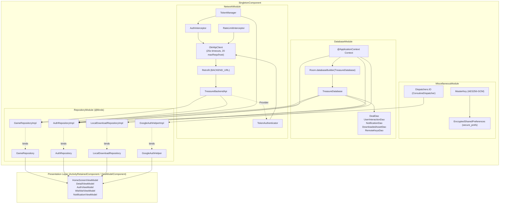

# Package Architecture: `com.example.treasure.di`

## 1. Overview & Architectural Scope

The `di` package contains the Dagger Hilt dependency injection modules governing object graphs, lifecycle scopes, and interface bindings across the `Treasure` application.

All modules in this package are installed into [`SingletonComponent::class`], ensuring that heavy infrastructural dependencies—such as SQLite Room database handles, OkHttp connection pools, Retrofit client proxies, encrypted keystore preferences, and repository singletons—are retained for the lifetime of the application process.

---

## 2. File Inventory & Architectural Taxonomy

| Subpackage | File / Component | Architectural Role | Key Responsibilities & Behaviors |
| :--- | :--- | :--- | :--- |
| `apiModule` | [`NetworkModule.kt`](apiModule/NetworkModule.kt) | Hilt Object Module | Provisions `OkHttpClient` (with 25s timeouts, custom 20-request/host dispatcher, logging, auth interceptor, rate-limiter, and authenticator), `Retrofit`, and `TreasureBackendApi`. |
| `databaseModule` | [`DatabaseModule.kt`](databaseModule/DatabaseModule.kt) | Hilt Object Module | Provisions `TreasureDatabase` via `Room.databaseBuilder()` and binds individual DAOs (`DealDao`, `DownloadedAssetDao`, `NotificationDao`, `RemoteKeysDao`, `UserInteractionDao`). |
| `miscellaneousModule` | [`MiscellaneousModule.kt`](miscellaneousModule/MiscellaneousModule.kt) | Hilt Object Module | Provisions application-wide `CoroutineDispatcher` (`Dispatchers.IO`) and Android Keystore AES256-GCM `EncryptedSharedPreferences`. |
| `repositoryModule` | [`RepositoryModule.kt`](repositoryModule/RepositoryModule.kt) | Hilt Abstract Module | Binds repository interfaces (`GameRepository`, `AuthRepository`, `LocalDownloadRepository`, `GoogleAuthHelper`) to concrete data implementations via `@Binds`. |

---

## 3. Core Dependency Injection Graph & Architecture

### A. Complete Dependency Flow Diagram

### B. Breaking Circular Dependencies with `Provider<T>`

An inherent circular dependency exists in OAuth-authenticated HTTP stacks:
1. `OkHttpClient` requires `TokenAuthenticator` to renew tokens upon HTTP 401 challenges.
2. `TokenAuthenticator` needs to invoke `TreasureBackendApi.refreshSessionSync()` to fetch renewed tokens.
3. `TreasureBackendApi` is constructed by `Retrofit`, which depends directly on `OkHttpClient`.

**Architectural Solution**: [`TokenAuthenticator`](../data/remote/apiService/TokenAuthenticator.kt) injects `Provider<TreasureBackendApi>` rather than a direct reference. This defers Retrofit instantiation until the moment a 401 challenge is actually caught at runtime, breaking the build-time circular graph cycle cleanly without memory leaks or crashes.

### C. Enterprise Security & Encryption Specification

In [`MiscellaneousModule.provideSharedPreference`](miscellaneousModule/MiscellaneousModule.kt), auth tokens and user data are encrypted at rest using Android Keystore:
- **Master Key**: Managed by the hardware-backed Android Keystore system (`MasterKey.KeyScheme.AES256_GCM`).
- **Key Encryption**: AES-256 in Synthetic Initialization Vector mode (`AES256_SIV`) for deterministically encrypted preference keys.
- **Value Encryption**: AES-256 in Galois/Counter Mode (`AES256_GCM`) for authenticated ciphertext values.

---

## 4. Testability & Threading Contracts

- **Dispatcher Injection**: By provisioning `CoroutineDispatcher` via [`MiscellaneousModule.providesCoroutineDispatcher`](miscellaneousModule/MiscellaneousModule.kt), test suites can substitute `Dispatchers.IO` with `StandardTestDispatcher` or `UnconfinedTestDispatcher` in unit tests, guaranteeing deterministic coroutine execution.
- **Interface Segregation**: All ViewModel dependencies communicate solely through abstract domain contracts bound in [`RepositoryModule`](repositoryModule/RepositoryModule.kt), allowing seamless mock injection (`FakeGameRepository`, `FakeAuthRepository`) in UI and integration tests.
