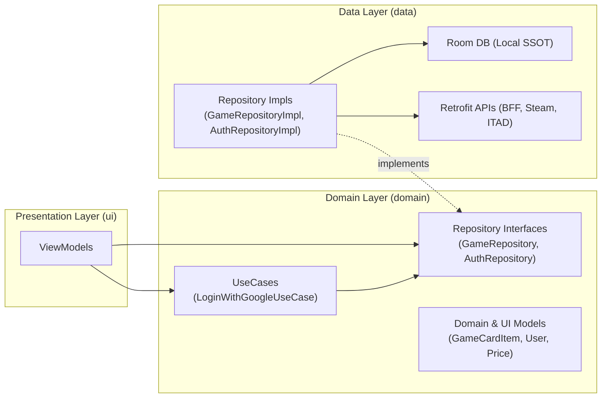
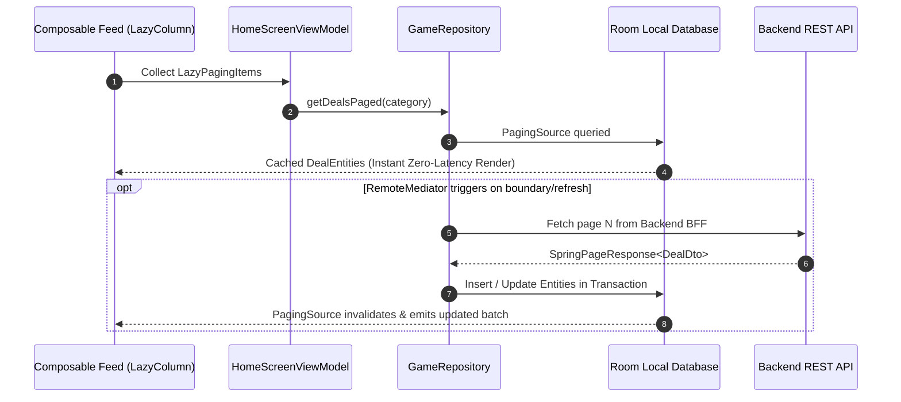
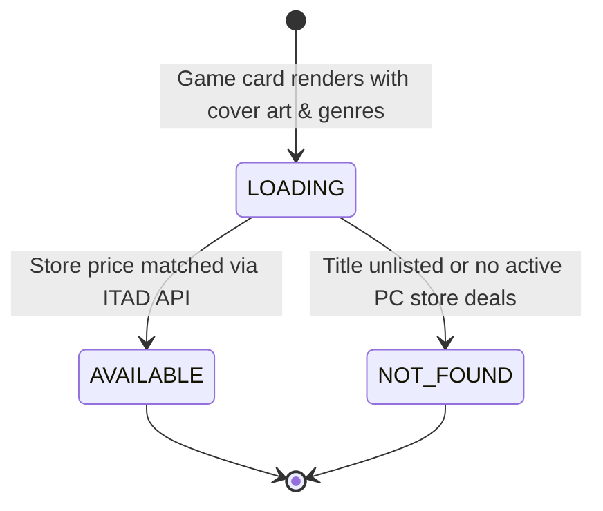

# Package Architecture: `com.example.treasure.domain`

## 1. Overview & Architectural Scope

The `domain` package encapsulates the core business logic, contracts, and presentation models of the `Treasure` application. In accordance with Clean Architecture principles:
- **Zero Android Framework Dependencies**: Domain models and use cases do not couple to Android UI controllers, Activities, or system services.
- **Repository Contracts**: Defines abstract interfaces (`AuthRepository`, `GameRepository`, `LocalDownloadRepository`) that establish contracts implemented by the `data` layer and injected via Hilt.
- **Unidirectional Data Flow (UDF)**: Exposes cold Kotlin Coroutine `Flow` streams for reactive UI observation and `suspend` functions returning `Result<T>` for asynchronous operations.

---

## 2. File Inventory & Architectural Taxonomy

| Subpackage | File / Component | Architectural Role | Key Responsibilities & Behaviors |
| :--- | :--- | :--- | :--- |
| `repository` | [`AuthRepository.kt`](repository/AuthRepository.kt) | Domain Contract | Authentication interface governing Google OAuth sign-in, logout, and backend account deletion. |
| `repository` | [`GameRepository.kt`](repository/GameRepository.kt) | Domain Contract | Core catalog contract for Paging 3 deal streams, lazy detail enrichment, search, and user interactions (cart/wishlist). |
| `repository` | [`LocalDownloadRepository.kt`](repository/LocalDownloadRepository.kt) | Domain Contract | Wallpaper and media download contract bridging local download tracking and asset queries. |
| `usecases` | [`LoginWithGoogleUseCase.kt`](usecases/LoginWithGoogleUseCase.kt) | Business Use Case | Validates Google OAuth ID token parameters and invokes backend verification via `AuthRepository`. |
| `uiModels` | [`AuthModels.kt`](uiModels/AuthModels.kt) | Domain Model | Serializable `User` profile entity (id, email, fullName, role, avatar). |
| `uiModels` | [`GameCardItem.kt`](uiModels/GameCardItem.kt) | Presentation Model | Card presentation model for feeds and grids, including `Price` and review sentiment `UpVotes`. |
| `uiModels` | [`DetailsScreen.kt`](uiModels/DetailsScreen.kt) | Presentation Model | Rich detail specifications: `GameDetailUiModel`, `StoreDeal`, `ImportantDetails`, and `SystemRequirement`. |
| `uiModels` | [`EpicFreeGameCard.kt`](uiModels/EpicFreeGameCard.kt) | Presentation Model | Free promotional game model for Epic Games Store weekly spotlights. |
| `uiModels` | [`EpicFreeGameDetail.kt`](uiModels/EpicFreeGameDetail.kt) | Presentation Model | Expanded promotional free game detail model with media and promotion windows. |
| `uiModels` | [`NewReleaseCard.kt`](uiModels/NewReleaseCard.kt) | Presentation Model | IGDB new release card supporting asynchronous price resolution (`PriceState`). |
| `uiModels` | [`SearchResult.kt`](uiModels/SearchResult.kt) | Presentation Model | Catalog search query result item model. |
| `uiModels` | [`TrendingGameCard.kt`](uiModels/TrendingGameCard.kt) | Presentation Model | High-velocity trending game card integrating IGDB charts with delayed ITAD pricing. |

---

## 3. Core Architecture & Data Flows

### A. Clean Architecture Boundary & Inversion of Control

The domain layer establishes boundaries between the presentation layer (`ui`) and the concrete data sources (`data`):

### B. Offline-First Paging 3 Architecture

[`GameRepository.getDealsPaged`](repository/GameRepository.kt) provides a continuous stream of paginated deals using Room as the Single Source of Truth:

### C. Asynchronous Two-Phase Price Enrichment

For external feeds (such as IGDB trending and new releases), titles are rendered immediately with metadata while pricing is resolved asynchronously:

### D. User Interaction & Offline-First Optimistic Sync

User actions (e.g. toggling a favorite or adding an item to the cart) are processed through [`GameRepository.toggleFavorite`](repository/GameRepository.kt):
1. **Immediate Local Mutation**: The interaction is written directly to the local Room database (`UserInteractionEntity`), triggering instant UI state emission via `observeInteractionIds()`.
2. **Background Cloud Sync**: For authenticated sessions, `syncWishlistFromCloud()` synchronizes local states with the backend BFF, reconciling delta changes across devices.

---

## 4. Threading & Concurrency Contract

- **Cold Streams**: All `Flow` instances exposed by repository contracts (`observeGameDetails`, `getCartItems`, `getWishlistItems`, `observeInteractionIds`) are cold streams executed on the collector's coroutine dispatcher.
- **Suspend Functions**: All repository mutations and network calls are `suspend` functions designed to be main-safe, delegating I/O-intensive work to `Dispatchers.IO` in concrete implementations.
- **Fail-Safe Monads**: Operations subject to network or auth failure return Kotlin `Result<T>` to force explicit handling of error branches without throwing unhandled exceptions.
