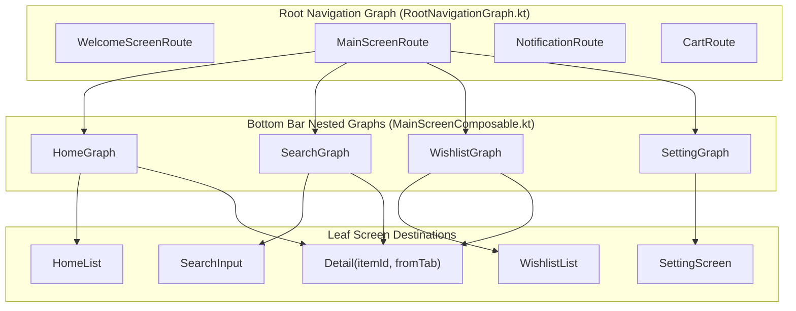
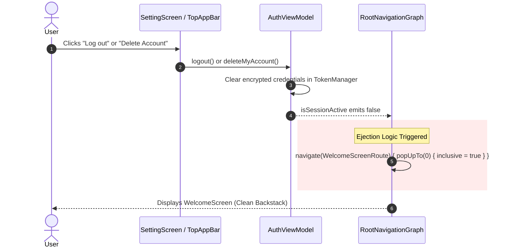

# Presentation Layer — Navigation Graphs (`com.example.treasure.ui.navigationGraphs`)

## 1. Architectural Overview

The `ui.navigationGraphs` package defines the **Type-Safe Navigation Architecture** for the **Treasure** application using **Jetpack Compose Navigation 2.8+** with **Kotlin Serialization**.

Instead of fragile string-based URI route patterns, routes and navigation arguments are represented as strongly-typed, `@Serializable` objects and data classes.

---

## 2. Route Hierarchy & File Taxonomy

| File | Primary Destination Types | Architectural Role |
| :--- | :--- | :--- |
| [`NavigationGraph.kt`](file:///c:/Users/Arnab%20Kumar%20Jana/Documents/Android%20Projects/Copies/Treasure/app/src/main/java/com/example/treasure/ui/navigationGraphs/NavigationGraph.kt) | `RootGraphDestination` `NestedGraphDestination` `LeafDestination` | Declares all `@Serializable` route contracts, destinations, nested graphs, and typed route arguments. |
| [`RootNavigationGraph.kt`](file:///c:/Users/Arnab%20Kumar%20Jana/Documents/Android%20Projects/Copies/Treasure/app/src/main/java/com/example/treasure/ui/navigationGraphs/RootNavigationGraph.kt) | `RootNavigationGraph` | Root NavHost coordinating the application lifecycle, dynamic start destination selection, and authentication session monitoring. |

---

## 3. Session State Monitoring & Ejection Flow

The [`RootNavigationGraph`](file:///c:/Users/Arnab%20Kumar%20Jana/Documents/Android%20Projects/Copies/Treasure/app/src/main/java/com/example/treasure/ui/navigationGraphs/RootNavigationGraph.kt) observes `AuthViewModel.isSessionActive`. If session credentials expire, or if the user initiates a logout or account deletion, the navigation system triggers an immediate ejection routine:

---

## 4. Custom Screen Transitions

Transitions between screens leverage the custom transition animation specs defined in [`Transitions.kt`](file:///c:/Users/Arnab%20Kumar%20Jana/Documents/Android%20Projects/Copies/Treasure/app/src/main/java/com/example/treasure/ui/Transitions.kt):
- **Tab Switching:** Fast `fadeIn(220ms)` and `fadeOut(220ms)` cross-fades between bottom navigation tabs.
- **Detail Transitions:** Directional horizontal slide animations:
  - Enter: `slideInFromRight()`
  - Exit: `slideOutToLeft()`
  - Pop Enter: `slideInFromLeft()`
  - Pop Exit: `slideOutToRight()`
