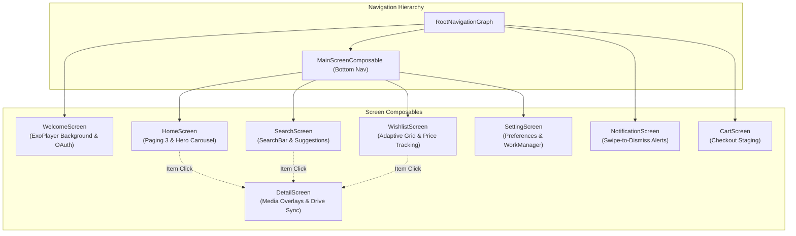

# Presentation Layer — Screens (`com.example.treasure.ui.screens`)

## 1. Architectural Overview

The `ui.screens` package hosts the top-level **Screen Composables** of the **Treasure** application. These screens act as the orchestrators connecting Hilt ViewModels to the stateless design system components (`ui.uiComponents`).

Every screen follows the **Stateful Screen / Stateless Content** split pattern:
1. **`*Screen` (Stateful Wrapper):** Injects ViewModels using `hiltViewModel()`, collects UI state via `collectAsStateWithLifecycle()`, and converts user interaction events into ViewModel method invocations.
2. **`*ScreenContent` (Stateless Presenter):** Receives plain data models and lambda callbacks, enabling preview rendering via `@Preview` without mocking Dagger/Hilt dependencies or coroutine scopes.

---

## 2. Screen Taxonomy & Capabilities

| Screen File | Key Composable(s) | Architectural Functionality & Integration |
| :--- | :--- | :--- |
| [`WelcomeScreen.kt`](file:///c:/Users/Arnab%20Kumar%20Jana/Documents/Android%20Projects/Copies/Treasure/app/src/main/java/com/example/treasure/ui/screens/WelcomeScreen.kt) | `WelcomeScreen`, `WelcomeScreenContent` | Onboarding screen with background looped, muted ExoPlayer video playback (`R.raw.bg_vid_01`). Features blur and dimming animations when opening the slide-up Google Sign-In sheet. |
| [`HomeScreen.kt`](file:///c:/Users/Arnab%20Kumar%20Jana/Documents/Android%20Projects/Copies/Treasure/app/src/main/java/com/example/treasure/ui/screens/HomeScreen.kt) | `HomeScreen`, `HomeScreenContent`, `GameHorizontalList` | Main discovery feed. Integrates the parallax `TreasureUpcomingCarousel` with multiple Paging 3 horizontal deal rails (Hot Deals, Lowest Price Ever, Mac Deals, Linux Deals). |
| [`DetailScreen.kt`](file:///c:/Users/Arnab%20Kumar%20Jana/Documents/Android%20Projects/Copies/Treasure/app/src/main/java/com/example/treasure/ui/screens/DetailScreen.kt) | `DetailScreen`, `DetailScreenContent`, `getDriveSyncIntent` | Detailed view for individual game deals. Features hero backdrop banner, metadata rows, expandable descriptions, media gallery reels, system specifications, and fullscreen image/video overlays. |
| [`MainScreenComposable.kt`](file:///c:/Users/Arnab%20Kumar%20Jana/Documents/Android%20Projects/Copies/Treasure/app/src/main/java/com/example/treasure/ui/screens/MainScreenComposable.kt) | `MainScreenComposable` | Primary container managing bottom navigation bar switching, nested sub-graphs, dynamic top app bar state, and deep link resolution (`treasure://wishlist`). |
| [`SearchScreen.kt`](file:///c:/Users/Arnab%20Kumar%20Jana/Documents/Android%20Projects/Copies/Treasure/app/src/main/java/com/example/treasure/ui/screens/SearchScreen.kt) | `SearchScreen`, `SearchScreenContent`, `SearchGameCard` | Search interface equipped with Material 3 `SearchBar`, quick tag suggestions ("Action", "RPG"), and an adaptive 2-column results grid. |
| [`WishlistScreen.kt`](file:///c:/Users/Arnab%20Kumar%20Jana/Documents/Android%20Projects/Copies/Treasure/app/src/main/java/com/example/treasure/ui/screens/WishlistScreen.kt) | `WishlistScreen`, `WishlistScreenContent` | Adaptive grid displaying user-favorited games with price drop comparisons (original price vs. latest synced cloud price). |
| [`SettingScreen.kt`](file:///c:/Users/Arnab%20Kumar%20Jana/Documents/Android%20Projects/Copies/Treasure/app/src/main/java/com/example/treasure/ui/screens/SettingScreen.kt) | `SettingScreen`, `SettingScreenContent`, `SelectionDialog` | Categorized user configuration screen: Appearance (Theme & Dynamic Colors), Wishlist Alerts (Sync frequency & notification threshold), Image Cache clearing, and Google Drive account management. |
| [`NotificationScreen.kt`](file:///c:/Users/Arnab%20Kumar%20Jana/Documents/Android%20Projects/Copies/Treasure/app/src/main/java/com/example/treasure/ui/screens/NotificationScreen.kt) | `NotificationScreen`, `NotificationScreenContent`, `NotificationItem` | Alert center displaying price drop notifications with swipe-to-dismiss gestures (`SwipeToDismissBox`) and bulk clear capabilities. |
| [`CartScreen.kt`](file:///c:/Users/Arnab%20Kumar%20Jana/Documents/Android%20Projects/Copies/Treasure/app/src/main/java/com/example/treasure/ui/screens/CartScreen.kt) | `CartScreen` | Placeholder staging area for shopping cart management and deal checkout. |

---

## 3. Deep Linking & Cross-Screen Navigation

The application registers deep link intent filters enabling external notifications and web links to open directly into destination screens:
- **Wishlist Deep Link:** `treasure://wishlist` navigates directly into [`WishlistScreen`](file:///c:/Users/Arnab%20Kumar%20Jana/Documents/Android%20Projects/Copies/Treasure/app/src/main/java/com/example/treasure/ui/screens/WishlistScreen.kt) via [MainScreenComposable.kt](file:///c:/Users/Arnab%20Kumar%20Jana/Documents/Android%20Projects/Copies/Treasure/app/src/main/java/com/example/treasure/ui/screens/MainScreenComposable.kt#L206).
- **Detail Screen Shared Route:** The [`DetailScreen`](file:///c:/Users/Arnab%20Kumar%20Jana/Documents/Android%20Projects/Copies/Treasure/app/src/main/java/com/example/treasure/ui/screens/DetailScreen.kt) composable is registered in each nested tab graph (`HomeGraph`, `SearchGraph`, `WishlistGraph`), ensuring backstack traversal returns naturally to the originating tab.
