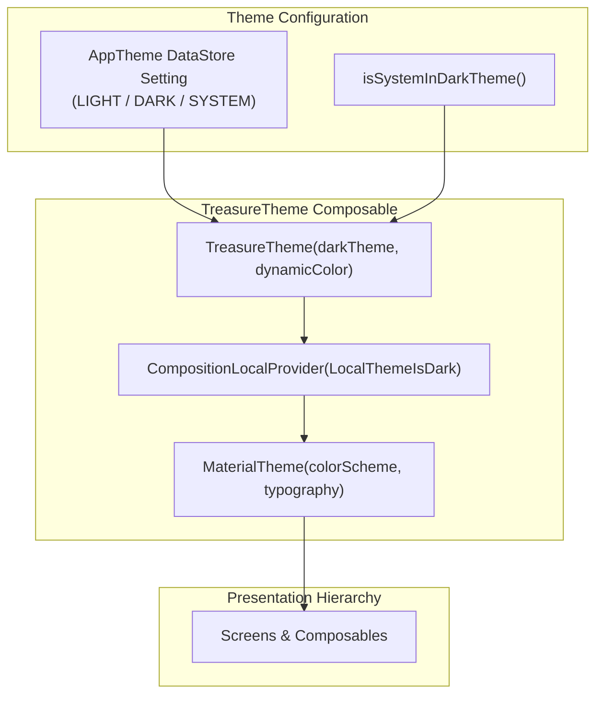
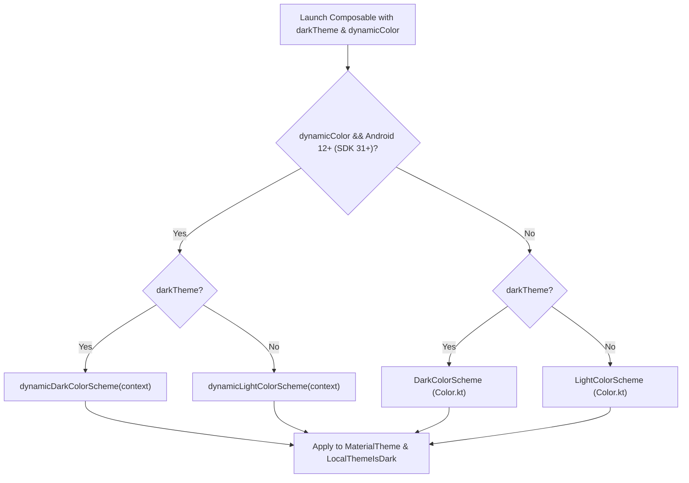

# Presentation Layer — Design System Theme (`com.example.treasure.ui.theme`)

## 1. Architectural Overview

The `ui.theme` package establishes the **Material Design 3 (M3)** design system for the **Treasure** application. It provides semantic color schemes, dynamic theming support (Android 12+ wallpaper extraction), typography hierarchies, and composition locals for runtime theme querying.

---

## 2. File Taxonomy & Capabilities

| File | Primary Symbols | Architectural Functionality |
| :--- | :--- | :--- |
| [`Color.kt`](file:///c:/Users/Arnab%20Kumar%20Jana/Documents/Android%20Projects/Copies/Treasure/app/src/main/java/com/example/treasure/ui/theme/Color.kt) | `DarkColorScheme`, `LightColorScheme` | Defines complete light and dark color schemes conforming to Material 3 tokens. Implements a high-contrast dark palette tailored for media-heavy game deals. |
| [`Theme.kt`](file:///c:/Users/Arnab%20Kumar%20Jana/Documents/Android%20Projects/Copies/Treasure/app/src/main/java/com/example/treasure/ui/theme/Theme.kt) | `TreasureTheme`, `LocalThemeIsDark` | Core theme wrapper composable. Manages dynamic color detection, configures window status and navigation bars via `LocalView`, and provides dark-mode state via `LocalThemeIsDark`. |
| [`Type.kt`](file:///c:/Users/Arnab%20Kumar%20Jana/Documents/Android%20Projects/Copies/Treasure/app/src/main/java/com/example/treasure/ui/theme/Type.kt) | `Typography`, `RobotoFontFamily` | Type scale definitions providing standard typographic hierarchy across headlines, titles, body, and labels with the Roboto font family. |

---

## 3. Dynamic Color & Theme Determination

The application dynamically decides the active palette based on platform version and user preferences:

---

## 4. Edge-to-Edge System Bars & Composition Locals

1. **System Bar Styling:** When the decor view is attached to a window, `TreasureTheme` sets the system status bar and navigation bar colors to transparent, and configures the `WindowInsetsControllerCompat` to toggle light or dark status bar icons to match the theme.
2. **`LocalThemeIsDark`:** Exposed as a `staticCompositionLocalOf<Boolean>`. Any child composable in the subtree can query `LocalThemeIsDark.current` without needing to pass flags through deep composable signatures.
