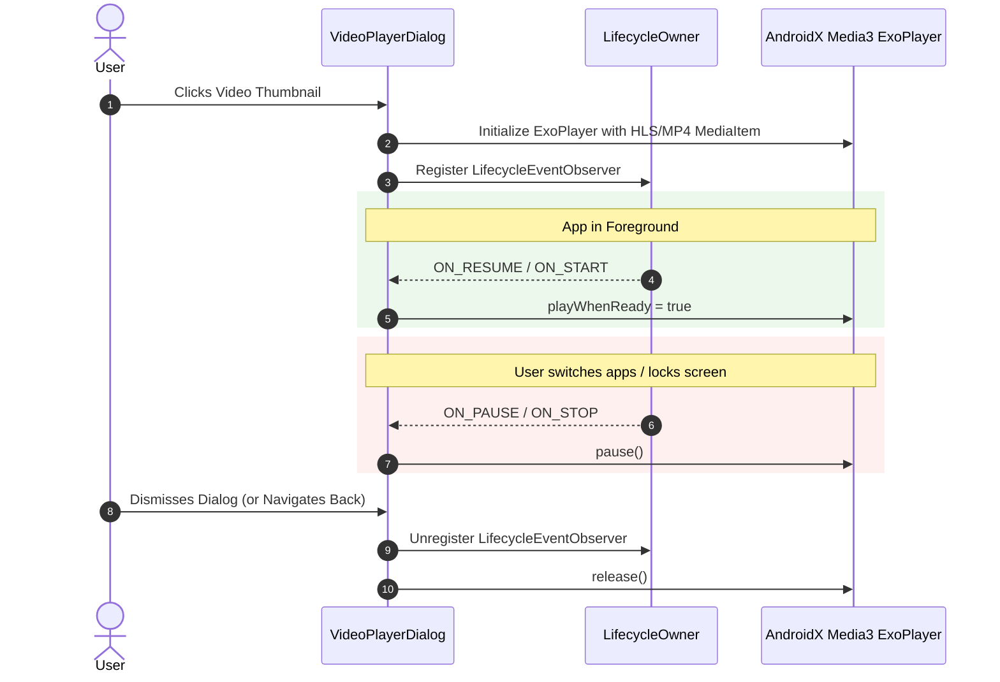
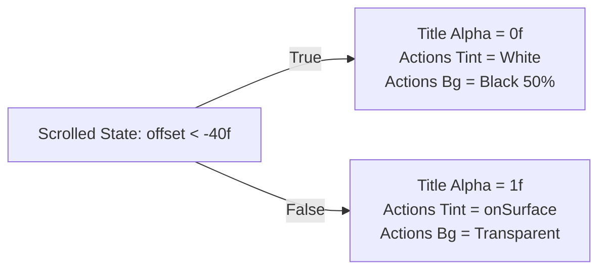

# Presentation Layer — UI Components (`com.example.treasure.ui.uiComponents`)

## 1. Architectural Overview

The `ui.uiComponents` package constitutes the design system component library for **Treasure**. Built entirely with **Jetpack Compose** and **Material 3**, this package hosts stateless, composable building blocks that form the visual foundation of the application. 

Every component adheres strictly to **Unidirectional Data Flow (UDF)** principles: state is hoisted to parent callers (screens or view models), and user interactions are propagated upward via idiomatic Kotlin lambda callbacks.

```mermaid
flowchart TD
    subgraph Screens["Screen Layer (Smart Composables)"]
        HS["HomeScreen"]
        DS["DetailScreen"]
        SS["SearchScreen"]
        WS["WishlistScreen"]
    end

    subgraph DesignSystem["Design System Components (Stateless)"]
        BNB["BottomNavBar"]
        TAB["TopAppBarComponent"]
        HC["HeroCarousel"]
        GC["GameCard"]
        GH["GameHeader"]
        MGR["MediaGalleryRow"]
        MVO["MediaOverlays\n(ExoPlayer & Coil Zoom)"]
        SRS["SystemRequirementsSection"]
        SHM["Shimmer Effect"]
        EXT["ExpandableText"]
        DIR["DetailInfoRow"]
    end

    Screens -->|Passes State| DesignSystem
    DesignSystem -->|Emits Events (Lambdas)| Screens
```

---

## 2. Component Taxonomy & Catalog

| Component File | Key Composable(s) | Architectural Role & Capabilities |
| :--- | :--- | :--- |
| [`BottomNavBar.kt`](file:///c:/Users/Arnab%20Kumar%20Jana/Documents/Android%20Projects/Copies/Treasure/app/src/main/java/com/example/treasure/ui/uiComponents/BottomNavBar.kt) | `BottomNavBar` | Anchored navigation bar providing cross-screen switching between Home, Wishlist, Search, and Settings. Includes route checking and unread indicator support. |
| [`TopAppBar.kt`](file:///c:/Users/Arnab%20Kumar%20Jana/Documents/Android%20Projects/Copies/Treasure/app/src/main/java/com/example/treasure/ui/uiComponents/TopAppBar.kt) | `TopAppBarComponent`, `ProfileDropdownMenu`, `DeleteAccountDialog` | Scroll-reactive top app bar. Animates title opacity and action button pill backgrounds based on scroll offset. Handles profile menu and destructive account deletion dialogs. |
| [`HeroCarousel.kt`](file:///c:/Users/Arnab%20Kumar%20Jana/Documents/Android%20Projects/Copies/Treasure/app/src/main/java/com/example/treasure/ui/uiComponents/HeroCarousel.kt) | `HeroCarousel` | Horizontal `HorizontalPager` carousel featuring automatic slide transitions, dynamic indicator pills, and high-impact hero deal showcase banners. |
| [`GameCard.kt`](file:///c:/Users/Arnab%20Kumar%20Jana/Documents/Android%20Projects/Copies/Treasure/app/src/main/java/com/example/treasure/ui/uiComponents/GameCard.kt) | `GameCard` | Versatile game deal display card supporting Free Games, Discount Deals, and Trending/New Release formats with discount percentage badges, store logos, and shimmer placeholders. |
| [`GameHeader.kt`](file:///c:/Users/Arnab%20Kumar%20Jana/Documents/Android%20Projects/Copies/Treasure/app/src/main/java/com/example/treasure/ui/uiComponents/GameHeader.kt) | `GameHeader` | Hero backdrop banner for the game details screen. Features a gradient scrim overlay, title text, pricing pill, and an interactive wishlist toggle button. |
| [`DetailInfoRow.kt`](file:///c:/Users/Arnab%20Kumar%20Jana/Documents/Android%20Projects/Copies/Treasure/app/src/main/java/com/example/treasure/ui/uiComponents/DetailInfoRow.kt) | `DetailInfoRow`, `StatItem`, `SectionTag` | Structured metadata grid presenting developer, publisher, release date, and categorical tags. |
| [`ExpandableText.kt`](file:///c:/Users/Arnab%20Kumar%20Jana/Documents/Android%20Projects/Copies/Treasure/app/src/main/java/com/example/treasure/ui/uiComponents/ExpandableText.kt) | `ExpandableText` | Collapsible multi-line text container with "Read more" / "Read less" toggling and animated container transitions. |
| [`MediaGalleryRow.kt`](file:///c:/Users/Arnab%20Kumar%20Jana/Documents/Android%20Projects/Copies/Treasure/app/src/main/java/com/example/treasure/ui/uiComponents/MediaGalleryRow.kt) | `MediaGalleryRow` | Horizontal scrolling reel displaying game screenshots and gameplay trailer video thumbnails. Differentiates video items with play badge indicators. |
| [`MediaOverlays.kt`](file:///c:/Users/Arnab%20Kumar%20Jana/Documents/Android%20Projects/Copies/Treasure/app/src/main/java/com/example/treasure/ui/uiComponents/MediaOverlays.kt) | `FullscreenImageViewer`, `VideoPlayerDialog` | Full-screen interactive media modals. Includes pinch-to-zoom Coil image viewing, ExoPlayer video playback with lifecycle management, and asset download triggers. |
| [`SystemRequirements.kt`](file:///c:/Users/Arnab%20Kumar%20Jana/Documents/Android%20Projects/Copies/Treasure/app/src/main/java/com/example/treasure/ui/uiComponents/SystemRequirements.kt) | `SystemRequirementsSection`, `BuyButton`, `RequirementGroup` | Hardware specifications breakdown (Minimum vs. Recommended) paired with outbound vendor purchase buttons linking directly to external storefronts. |
| [`Shimmer.kt`](file:///c:/Users/Arnab%20Kumar%20Jana/Documents/Android%20Projects/Copies/Treasure/app/src/main/java/com/example/treasure/ui/uiComponents/Shimmer.kt) | `Modifier.shimmerEffect()` | Compose layout modifier extending infinite transition animations with animated gradient brushes for skeleton loading states. |

---

## 3. Media Player Lifecycle & Resource Management

The [`VideoPlayerDialog`](file:///c:/Users/Arnab%20Kumar%20Jana/Documents/Android%20Projects/Copies/Treasure/app/src/main/java/com/example/treasure/ui/uiComponents/MediaOverlays.kt#L180-L245) composable encapsulates AndroidX Media3 `ExoPlayer` integration inside Compose. To ensure zero memory leaks and prevent background audio playback when the app is backgrounded, it hooks directly into the host `LifecycleOwner`:



---

## 4. Scroll-Linked Adaptive App Bar Mechanics

The [`TopAppBarComponent`](file:///c:/Users/Arnab%20Kumar%20Jana/Documents/Android%20Projects/Copies/Treasure/app/src/main/java/com/example/treasure/ui/uiComponents/TopAppBar.kt) reacts dynamically to content scroll offsets using Material 3's `TopAppBarScrollBehavior`.



This creates an immersive edge-to-edge experience where backdrop headers flow naturally behind the app bar, and controls remain legible across bright and dark backgrounds.
