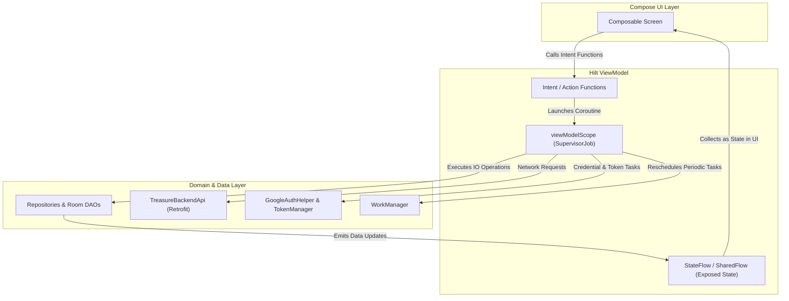
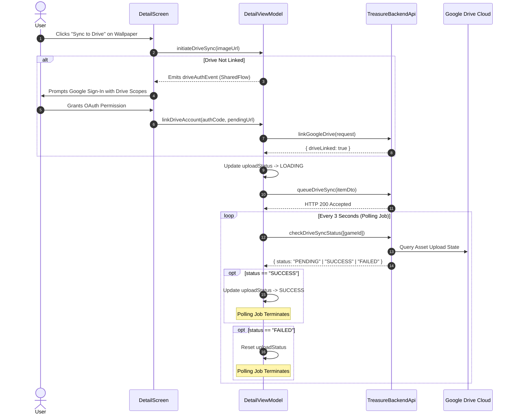

# Presentation Layer — ViewModels (`com.example.treasure.ui.viewModels`)

## 1. Architectural Role & Design Philosophy

The `ui.viewModels` package houses the state holders and business logic coordinators for the **Treasure** Android application. 

Every ViewModel is managed by **Hilt** (`@HiltViewModel`) and bound to the Jetpack Compose presentation layer using **Unidirectional Data Flow (UDF)**:
- **State flows downward:** ViewModels expose immutable `StateFlow` and `SharedFlow` streams to Composable screens.
- **Events flow upward:** Screens emit user intents (clicks, text input, navigation triggers) as function calls into ViewModels.
- **State Invalidation & Configuration Resistance:** Heavy Room and repository queries are shared and cached using `.stateIn(viewModelScope, SharingStarted.WhileSubscribed(5000), ...)`, providing a 5-second buffer across activity recreations and configuration changes without thrashing database observers.

---

## 2. ViewModel Taxonomy & Capabilities

| ViewModel | Key State & Flow Streams | Key Action Methods | Primary Responsibilities |
| :--- | :--- | :--- | :--- |
| [`AuthViewModel.kt`](file:///c:/Users/Arnab%20Kumar%20Jana/Documents/Android%20Projects/Copies/Treasure/app/src/main/java/com/example/treasure/ui/viewModels/AuthViewModel.kt) | `isSessionActive: StateFlow<Boolean>` `isLoading: StateFlow<Boolean>` `error: StateFlow<String?>` | `handleGoogleLogin()` `deleteMyAccount()` `logout()` | Coordinates Google Credential Manager authentication, server JWT verification, automatic post-login cloud wishlist synchronization, and account deletion. |
| [`DetailViewModel.kt`](file:///c:/Users/Arnab%20Kumar%20Jana/Documents/Android%20Projects/Copies/Treasure/app/src/main/java/com/example/treasure/ui/viewModels/DetailViewModel.kt) | `gameDetail: StateFlow<DealEntity?>` `downloadStatuses: StateFlow<Map<String, ActionStatus>>` `isDriveLinked: StateFlow<Boolean>` `uploadStatuses: StateFlow<Map<String, ActionStatus>>` `driveAuthEvent: SharedFlow<Unit>` | `fetchGameDetails()` `toggleFavorite()` `downloadWallpaperLocal()` `initiateDriveSync()` `linkDriveAccount()` | Manages deep game detail enrichment, Room caching, local wallpaper downloads via `DownloadManager`, and asynchronous Google Drive cloud backup with polling. |
| [`HomeScreenViewModel.kt`](file:///c:/Users/Arnab%20Kumar%20Jana/Documents/Android%20Projects/Copies/Treasure/app/src/main/java/com/example/treasure/ui/viewModels/HomeScreenViewModel.kt) | `hotDeals: Flow<PagingData<GameCardItem>>` `lowestPriceDeals: Flow<PagingData<GameCardItem>>` `macDeals: Flow<PagingData<GameCardItem>>` `linuxDeals: Flow<PagingData<GameCardItem>>` `anticipatedGames: StateFlow<List<GameCardItem>>` `favoriteIds: StateFlow<Set<String>>` `cartIds: StateFlow<Set<String>>` | `toggleFavorite()` `toggleCart()` | Powers the home feed with categorized Paging 3 deal streams (`DealRemoteMediator`), hero carousel banners, and reactive sidecar sets for instant heart/cart icon states. |
| [`MainViewModel.kt`](file:///c:/Users/Arnab%20Kumar%20Jana/Documents/Android%20Projects/Copies/Treasure/app/src/main/java/com/example/treasure/ui/viewModels/MainViewModel.kt) | `currentUser: StateFlow<User?>` | *Synchronous state observation* | Exposes top-level authenticated user profile data retrieved from encrypted SharedPreferences to app bars and root navigation graphs. |
| [`NotificationViewModel.kt`](file:///c:/Users/Arnab%20Kumar%20Jana/Documents/Android%20Projects/Copies/Treasure/app/src/main/java/com/example/treasure/ui/viewModels/NotificationViewModel.kt) | `notifications: StateFlow<List<NotificationEntity>>` `unreadCount: StateFlow<Int>` | `clearAll()` `deleteNotification()` `markAllAsRead()` | Observes Room database alerts, maintains unread badge counts, and executes dismissal or read-status mutations. |
| [`SearchViewModel.kt`](file:///c:/Users/Arnab%20Kumar%20Jana/Documents/Android%20Projects/Copies/Treasure/app/src/main/java/com/example/treasure/ui/viewModels/SearchViewModel.kt) | `searchQuery: StateFlow<String>` `searchResults: StateFlow<List<GameCardItem>>` `isSearching: StateFlow<Boolean>` | `onQueryChange()` `performSearch()` | Isolates search input query changes from network execution to avoid API thrashing; queries repository only on explicit submission. |
| [`SettingsViewModel.kt`](file:///c:/Users/Arnab%20Kumar%20Jana/Documents/Android%20Projects/Copies/Treasure/app/src/main/java/com/example/treasure/ui/viewModels/SettingsViewModel.kt) | `uiState: StateFlow<SettingsUiState>` | `updateTheme()` `toggleDynamicColors()` `toggleNotifications()` `updateSyncFrequency()` `clearImageCache()` `linkDriveAccount()` `unlinkDrive()` | Consolidates DataStore user preferences into a single state stream, dynamically updates WorkManager periodic price sync requests, and evicts Coil image caches. |
| [`WishlistViewModel.kt`](file:///c:/Users/Arnab%20Kumar%20Jana/Documents/Android%20Projects/Copies/Treasure/app/src/main/java/com/example/treasure/ui/viewModels/WishlistViewModel.kt) | `wishlistItems: StateFlow<List<UserInteractionEntity>>` | `toggleFavorite()` `toggleCart()` | Exposes a reactive Room stream of wishlist entries and executes favorite/cart state transitions. |

---

## 3. Asynchronous Google Drive Sync & Polling Flow

In [`DetailViewModel`](file:///c:/Users/Arnab%20Kumar%20Jana/Documents/Android%20Projects/Copies/Treasure/app/src/main/java/com/example/treasure/ui/viewModels/DetailViewModel.kt), wallpapers can be backed up to the user's private Google Drive through a server-side asynchronous task pipeline.

---

## 4. Lifecycle Awareness & Cancellation

1. **`SharingStarted.WhileSubscribed(5000)`:** Ensures database observers halt when the app is placed in the background or during deep navigation transitions, while remaining active during brief configuration rotations (which typically take under 500ms).
2. **`onCleared()` Handling:** Active background polling jobs tracked in `DetailViewModel.pollingJobs` are explicitly cancelled to prevent thread leaks or outbound HTTP polls after the user exits the details screen.
3. **Dispatchers:** Network and disk-intensive tasks are dispatched on `Dispatchers.IO` while Compose-facing states are mutated on the Main thread within `viewModelScope`.
