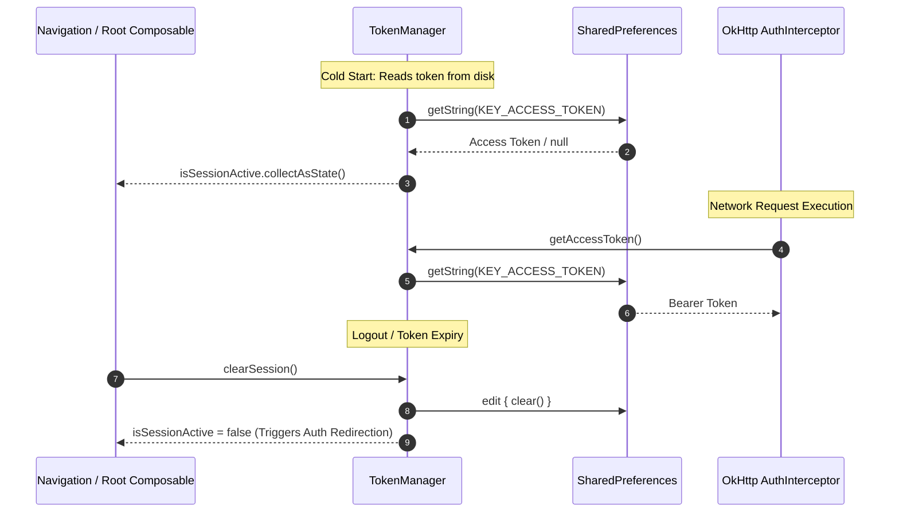
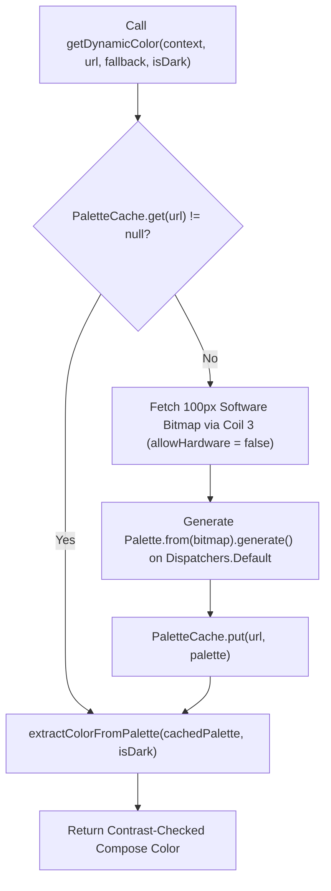

# Package Architecture: `com.example.treasure.utils`

## 1. Overview & Architectural Scope

The `utils` package serves as the foundational infrastructure layer for the `Treasure` application. It provides cross-cutting domain primitives, platform configurations, security/session token persistence, system notification dispatchers, dynamic color palette extraction, and top-level navigation descriptors.

Components in this package are decoupled from specific UI screens and business ViewModels, providing reusable services, singleton state holders, and hardware/OS bridges.

---

## 2. File Inventory & Architectural Taxonomy

| File / Component | Architectural Role | Key Responsibilities & Behaviors |
| :--- | :--- | :--- |
| [`ActionStatus.kt`](ActionStatus.kt) | Core Enum | Tri-state execution lifecycle (`IDLE`, `LOADING`, `SUCCESS`) for asynchronous UI actions and loading indicators. |
| [`ColorCode.kt`](ColorCode.kt) | Visual Semantic Enum | Tri-state semantic color token (`GREEN`, `YELLOW`, `RED`) reflecting ratings, price drops, and discount metrics. |
| [`Constants.kt`](Constants.kt) | Global Configuration | Static compile-time constants: Database name, backend BFF URL, Steam API, ITAD API, and Google OAuth Web Client ID. |
| [`Maturity.kt`](Maturity.kt) | Domain Model & Parser | Normalizes international age ratings (ESRB & PEGI) and provides fallback parsing via `fromSteamRating()`. |
| [`PaletteCache.kt`](PaletteCache.kt) | In-Memory Memory Cache | Thread-safe LRU cache (`LruCache<String, Palette>`, capacity 20) preventing redundant image decompression/quantization. |
| [`Platform.kt`](Platform.kt) | System Enum | Target PC operating systems (`WINDOWS`, `LINUX`, `MAC`) for compatibility badges and hardware requirements. |
| [`PriceNotificationManager.kt`](PriceNotificationManager.kt) | System Service & Hilt Module | Manages Android notification channels (`price_alert_channel`), single/batched alerts, and deep-link intents (`treasure://wishlist`). |
| [`Stores.kt`](Stores.kt) | Catalog Enum | Aggregated PC storefront enumerations (`STEAM`, `EPIC`, `GOG`) for deal filtering and attribution. |
| [`TokenManager.kt`](TokenManager.kt) | Session & Auth Store | Manages JWT access/refresh tokens in `SharedPreferences` and publishes observable session state via `StateFlow<Boolean>`. |
| [`helper/ExtractPalette.kt`](helper/ExtractPalette.kt) | Coroutine Color Utility | Asynchronously extracts contrast-compliant dynamic surface colors from remote game images using Coil 3 and AndroidX Palette. |
| [`navigation/MainScreen.kt`](navigation/MainScreen.kt) | Navigation Contract | Sealed class defining the bottom navigation destinations (`Home`, `Search`, `Wishlist`, `Setting`) and icon assets. |

---

## 3. Core Architecture & Data Flows

### A. Session Management & Reactive Auth Stream

[`TokenManager`](TokenManager.kt) maintains the single source of truth for user authentication state across the app. It holds an observable `_isSessionActive: MutableStateFlow<Boolean>` that initializes based on access token presence during cold start.

### B. Price Alert Notification Pipeline

Background sync workers ([`PriceSyncWorker`](../workers/PriceSyncWorker.kt)) query for wishlisted title price changes. When changes occur, they delegate dispatching to [`PriceNotificationManager`](PriceNotificationManager.kt):

- **Single Updates**: Dispatched using `showSingleGameNotification(item)`. Uses `item.gameId.hashCode()` as notification ID to prevent clobbering other game updates.
- **Batched Updates**: When multiple games update simultaneously, `showBatchedNotification(items)` aggregates them into an `InboxStyle` notification with summary indicators (`↓` for drops, `↑` for hikes) under ID `999`.
- **Deep Linking**: All notifications attach a `PendingIntent` referencing the custom deep link `treasure://wishlist` with `FLAG_ACTIVITY_NEW_TASK` and `FLAG_ACTIVITY_CLEAR_TASK`.

### C. Dynamic Palette Extraction & Hardware Decoupling

Extracting colors from remote game key art requires software bitmap processing. [`helper/ExtractPalette.kt`](helper/ExtractPalette.kt) operates off the main thread:

---

## 4. Concurrency & Threading Model

- **Session Data**: [`TokenManager`](TokenManager.kt) operations are thread-safe, utilizing Android's thread-safe preference implementation and atomic state updates on `MutableStateFlow`.
- **Palette Processing**: Bitmap decoding and palette generation in [`ExtractPalette.kt`](helper/ExtractPalette.kt) are explicitly isolated to `Dispatchers.Default` using `withContext`, ensuring zero UI stutters or dropped frames during LazyList scrolling.
- **Notification Services**: [`PriceNotificationManagerImpl`](PriceNotificationManager.kt) safely interacts with system services on any caller thread.
