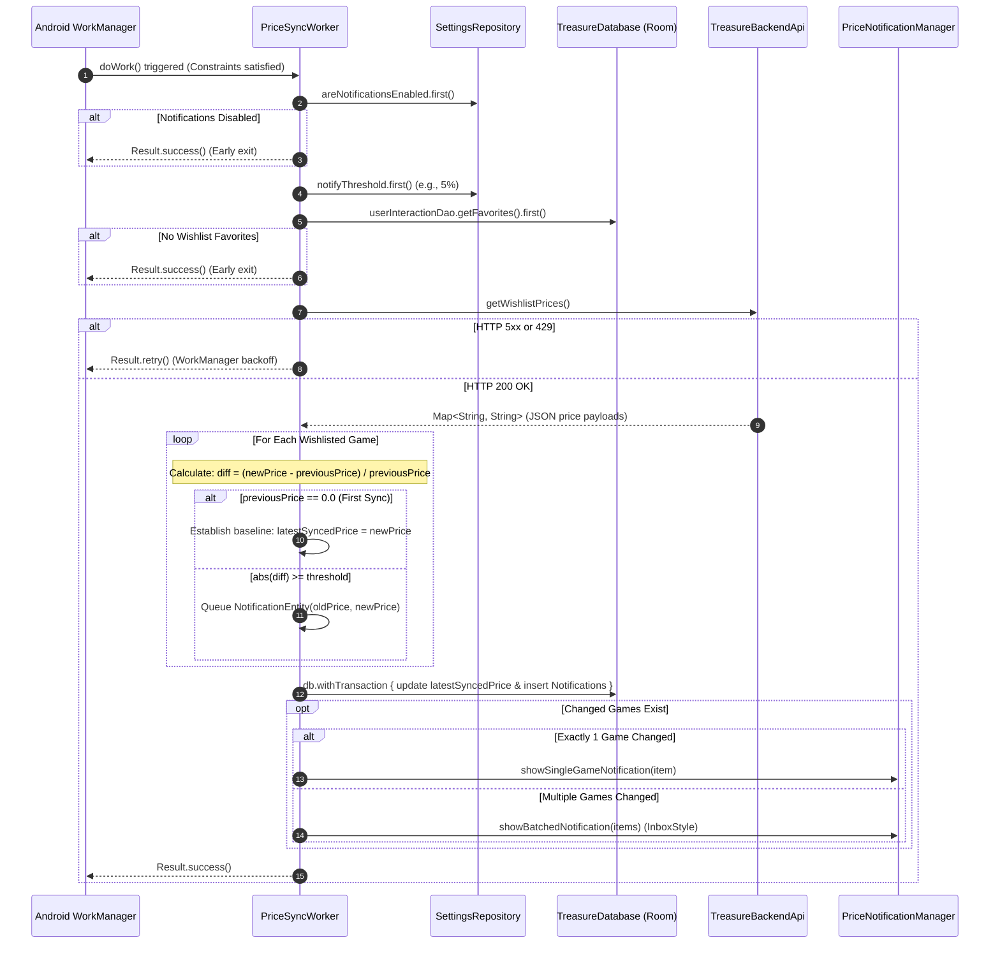

# Package Architecture: `com.example.treasure.workers`

## 1. Overview & Architectural Scope

The `workers` package houses the application's background synchronization engines managed by **Android Jetpack WorkManager** and dependency-injected via Dagger Hilt's `@HiltWorker` extension.

Key Architectural Responsibilities:
- **Autonomous Wishlist Price Tracking**: Periodically audits price fluctuations across all wishlisted titles while the app is in the background or closed.
- **Battery & Network Conscious Execution**: Enforces strict system constraints—executing solely when the device is connected to an unmetered or metered network (`NetworkType.CONNECTED`) and battery is healthy (`setRequiresBatteryNotLow(true)`).
- **Intelligent Alert Throttling**: Compares price deltas against the user's custom percentage threshold ([`SettingsRepository`](../data/repositoryImpl/SettingsRepository.kt)), preventing notification fatigue.
- **Transactional State Persistence**: Updates price baselines in Room within isolated transactions and delegates notifications to [`PriceNotificationManager`](../utils/PriceNotificationManager.kt).

---

## 2. File Inventory & Architectural Taxonomy

| File / Component | Architectural Role | Key Responsibilities & Behaviors |
| :--- | :--- | :--- |
| [`PriceSyncWorker.kt`](PriceSyncWorker.kt) | CoroutineWorker | Periodic background sync worker polling backend wishlist price feeds, evaluating baseline delta thresholds, and scheduling price alerts. |

---

## 3. Core Architecture & Synchronization Flows

### A. Price Tracking Lifecycle Sequence

### B. Price Delta & Threshold Evaluation Formula

Price changes are evaluated on each cycle against the title's **previously synchronized baseline** (`UserInteractionEntity.latestSyncedPrice`):

$$\Delta\% = \frac{|P_{\text{new}} - P_{\text{previous}}|}{P_{\text{previous}}} \times 100$$

- **First Sync**: If $P_{\text{previous}} \le 0.0$, the worker records the initial price snapshot without firing an alert.
- **Threshold Gate**: An alert is queued only when $\Delta\% \ge \text{userThreshold}\%$.
- **Baseline Advance**: Whenever $P_{\text{new}} \ne P_{\text{previous}}$, the database snapshot updates to $P_{\text{new}}$ to ensure future comparisons measure fresh shifts rather than repeating stale alerts.

### C. Single vs. Batched Notification Delivery

To protect the user's notification drawer from spam when major seasonal sales launch:
- **Single Game Change**: Dispatched via `showSingleGameNotification(item)` with title, new price, discount indicator (`↓` or `↑`), and direct deep link `treasure://wishlist`.
- **Multiple Game Changes**: Dispatched via `showBatchedNotification(items)`, summarizing up to 5 games in a compact `NotificationCompat.InboxStyle` notification tray element under static ID `999`.

---

## 4. Resilience & Retry Strategy

- **Transient Outages**: If the backend returns HTTP 500-599 or HTTP 429, the worker exits with [`Result.retry()`], allowing WorkManager to re-schedule execution using exponential backoff.
- **Permanent Client Failures**: Unrecoverable HTTP 4xx responses exit with [`Result.failure()`].
- **Dispatcher Concurrency**: The worker delegates all parsing, database I/O, and HTTP communication to `ioDispatcher` (`Dispatchers.IO`), ensuring zero background thread contention on the main thread.
